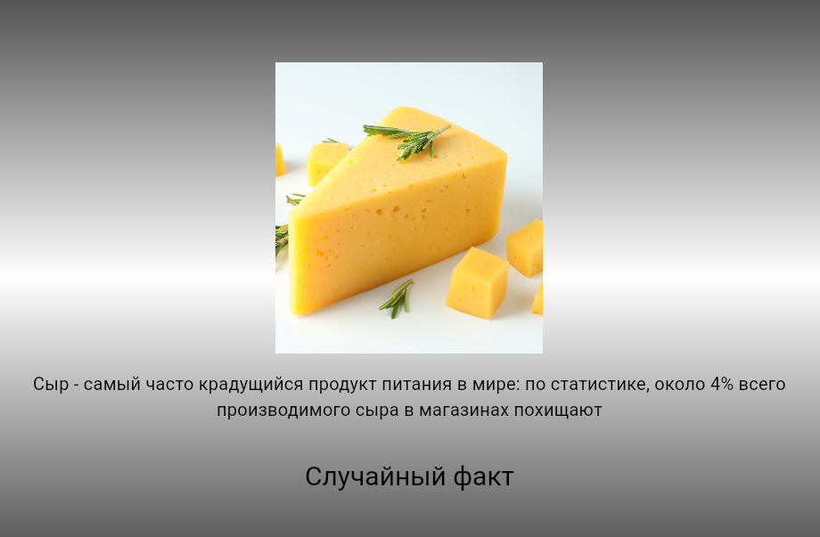

# Карточки с фактами
## Нажав на кнопку, вы получите забавный факт!

## Вовк Тимофей ИСП-242 17.10.2026

## Стек и версии
- Flutter: 3.47.6
- Dart: 3.13.5
- Платформа: Web (**Edge**)
- IDE: VS Code

## Скриншот приложения

## Структура проекта

## Как запустить

- git clone <[ссылка на репозиторий](https://github.com/Westigrannik/Flutter_Lab6.git)>
- cd <папка проекта>
- flutter pub get
- flutter run -d chrome

## Что изучили 

1. Изучили. как работать с рандомом
2. Изучили. как работать со списками
3. Изучили, как с помощью рандома работать со списками
4. Изучили, как делать своё приложение